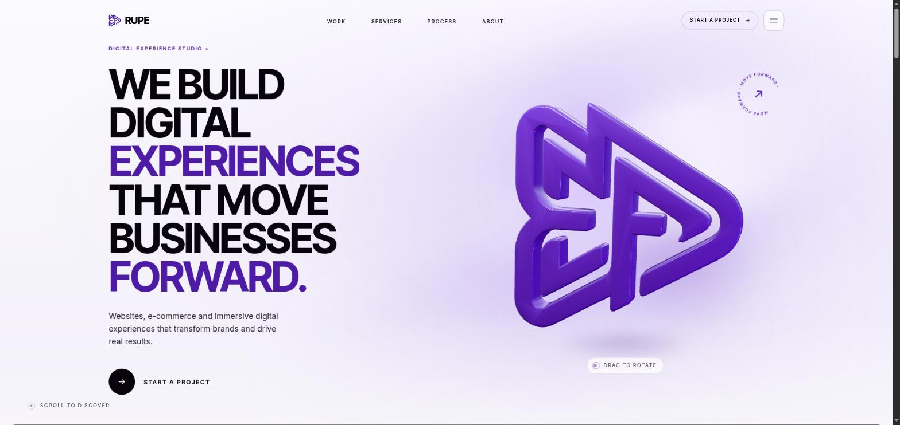
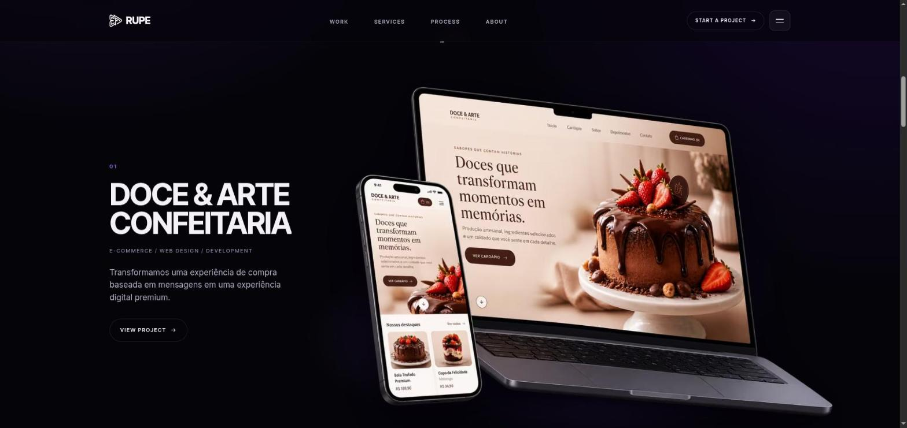

# RUPE — Digital Experience Studio

Single-page site for the RUPE studio, built from the layout reference in `assests/`.
The hero mark is a procedural Three.js reconstruction of the brand symbol — geometry
measured from the source art, not a textured plane or a tilted PNG.

## Run

```bash
npm install
npm run dev        # http://localhost:5173
npm run build      # type-check + production bundle into dist/
npm run preview
npm run logo:trace # re-derive the mark geometry from assests/ (needs python3 + numpy/scipy/PIL/matplotlib)
```

`dev` and `preview` both bind to every interface, so the site is reachable from a phone
on the same network at `http://<your-lan-ip>:5173` — Vite prints the address as
`Network:` on startup.

Responsive checks without resizing the window:
`http://localhost:5173/tools/viewport.html?w=390&h=760` frames the site at any viewport.
It lives outside `public/`, so it never ships in a build.



## Structure

```
src/
  components/   Navbar, Hero, HeroMark, Portfolio, ProjectCase, Pricing,
                CaseMockup, CaseScreens, Services, Process, About,
                FinalCTA, Footer, RupeMark, ArrowButton
  three/        createRupeLogo.ts · materials.ts · LogoScene.ts · rupeMarkPath.ts (generated)
  hooks/        useSmoothScroll · useReveal · useMagnetic · useMediaQuery · usePrefersReducedMotion
  lib/          gsap.ts (single plugin registration)
  styles/       tokens.css · base.css · ui.css
tools/          logo tracing + verification pipeline (Python) + viewport.html dev harness
docs/           logo-reconstruction.md — how the 3D mark was rebuilt and verified
.img2threejs/   img2threejs pipeline state + sculpt spec
```

Stack: React 19 + TypeScript + Vite, three.js (vanilla, wrapped in a lifecycle class),
GSAP/ScrollTrigger, Lenis, hand-written CSS with design tokens. Stylesheets load
globals first (`main.tsx`) then component CSS, so component rules win the cascade.

## The case mockup

`CaseMockup` presents the Doce & Arte case with the approved composition asset, used
exactly as delivered. The source carries a real cutout alpha — laptop and phone
silhouetted, no rectangular backdrop — so it sits straight on the dark section with no
edge to disguise. Everything the component adds paints *behind* the artwork: an ambient
violet radial, a pool of contact light under the base, and a drop-shadow to ground the
devices. Nothing filters or recolours the image itself.

`.mockup__tilt` is the one motion it keeps: a lerped pointer response bounded to
±6px / ±4px and half a degree. Until the image arrives the mockup shows the loading
skeleton in its place.

The cases sit in a sideways carousel (`Portfolio.tsx`): native horizontal scroll with
scroll-snap, so touch, trackpad and the arrow keys work without script, plus previous /
next buttons, a counter and press-and-drag for a mouse. Every slide stays in the DOM, so
all of them are in the prerendered HTML.

Served as AVIF with a WebP fallback at 768 / 1024 / 1513 widths — 40K on mobile against
the 2MB source. See `public/cases/doce-e-arte/README.md` for the encode recipe.



## The 3D mark

`createRupeLogo()` returns a `THREE.Group`, so the page controls `position`, `rotation`
and `scale` directly; `setMaterial()` reaches the shared material and `dispose()`
releases everything.

On the page it holds still: `HeroMark` builds the scene frozen and non-interactive
(`reducedMotion: true`, `interactive: false`), draws one three-quarter pose inside the
hero's logo slot, and parks — no drag, no idle drift, no scroll choreography. The
scene's drag and spin code is still in `src/three/LogoScene.ts` behind those options. The silhouette comes from `src/three/rupeMarkPath.ts`, generated by
`tools/export_logo.py` and verified at **IoU 0.970** against the source art — the
residual is the antialias fringe of the reference PNG. See `docs/logo-reconstruction.md`.

The same contour data draws the 2D mark in the navbar, footer, About section and final
CTA (`src/components/RupeMark.tsx`), so the flat and extruded marks stay in sync.

Performance: three.js loads on its own chunk after first paint, the scene draws once
and stops, DPR is capped at 1.75 (1.5 mobile), and mobile drops to two lights and a
coarser bevel. Until the first frame lands, the logo slot shows the loading skeleton.

## Loading

The preloader is the mark and RUPE, about 1.6 s, entirely CSS — it is in the
prerendered HTML, so it plays from first paint, before any JavaScript arrives.
If the JavaScript is slower than that, the page underneath shows a skeleton: an inline
script sets `is-booting` on `<html>`, every element still waiting for a reveal is drawn
as a shimmering bar in its own shape (`src/styles/base.css`), and `useBooted` removes the
class once React has hydrated.

## Placeholders to replace before launch

- **Maintenance prices** — `care.price: null` in each `src/i18n/*.ts` (shows "Sob consulta" /
  "On request" until set; the JSON-LD only lists it once it has a price).
- **Social links** — the `#` links in `src/components/Footer.tsx`.
- **Legal pages** — `/privacidade`, `/cookies` and their `/br/` and `/us/` equivalents
  are linked from the footer but do not exist yet.
- **Cases 02 and 03** — still "Próximo projeto · Em breve" in the carousel.

## Markets

One app, three prerendered pages: `/` (Portugal, pt-PT), `/br/` (Brasil, pt-BR,
written for Curitiba) and `/us/` (United States, en-US). All copy lives in
`src/i18n/`, one file per market, checked against one `Content` type. The build fills
each page's head (title, canonical, hreflang, Open Graph, JSON-LD) from the same files
and prerenders the body, so crawlers get the full text without running JavaScript.
The domain is `SITE_URL` in `vite.config.ts` (default `https://www.rupeai.pt`; rupeai.pt redirects to it).

Each market also has a blog — `/blog/`, `/br/blog/`, `/us/blog/` — built from Markdown in
`content/blog/<locale>/`, one prerendered page per post, listed in the sitemap and
described with `BlogPosting` structured data.

## Leads and automation

The brief form at the bottom of every page (`LeadForm.tsx`) posts multipart/form-data —
the visitor's details, colours and logo — to the n8n webhook in `VITE_LEADS_WEBHOOK_URL`
(`.env.production`). `automation/` holds the two n8n workflows to import: one emails each
lead to rupe@rupeai.pt and confirms to the visitor, the other emails weekly blog ideas
written by Claude. Setup steps are in `automation/README.md`.

No metrics, results or client names beyond Doce & Arte appear anywhere on the page —
none were supplied, so none were invented.
